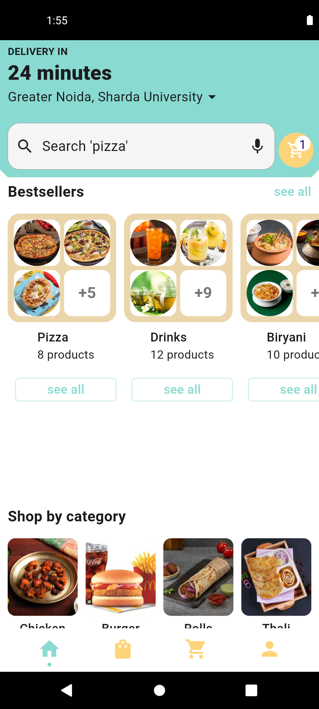
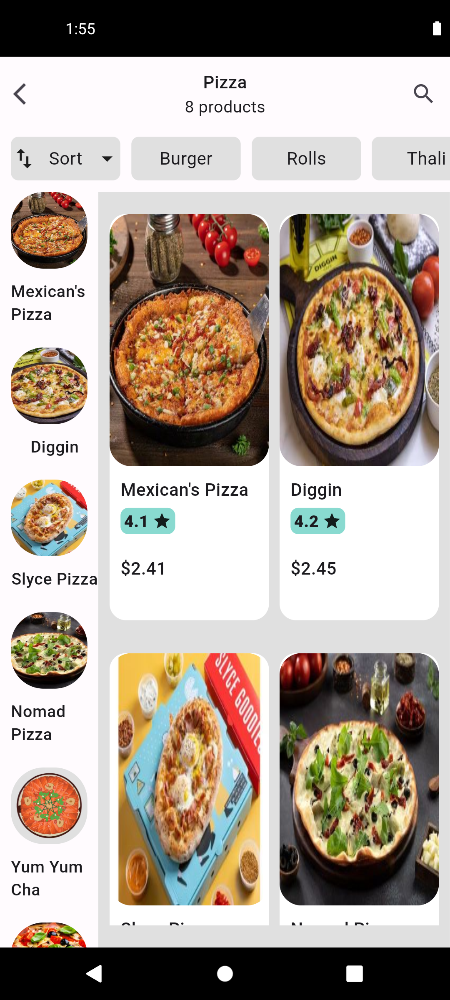
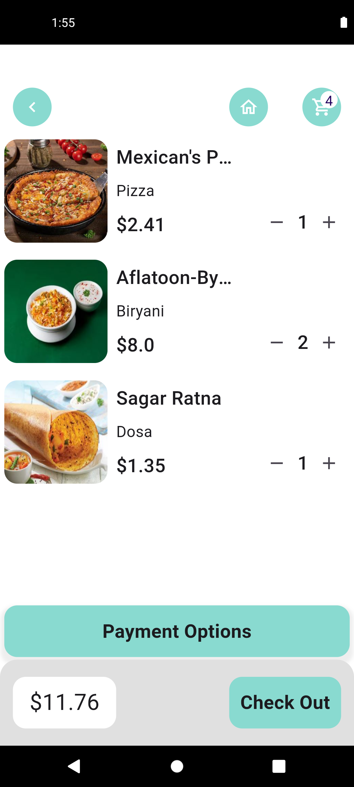

# The Best Food — Full-Stack Food Delivery & Restaurant Management App

A complete full-stack mobile food delivery and restaurant ordering application built with **Flutter (Dart)** and a **Laravel (PHP)** REST API backend. Engineered with **Clean Architecture**, modular feature separation, secure authentication, and real-time order workflows.

---

## 📱 UI Screenshots & Demo

| Home & Food Categories | Menu & Item Details | Cart & Order Tracking |
| :---: | :---: | :---: |
|  |  |  |

*(Replace `home.png`, `details.png`, and `cart.png` above with the exact filenames inside your `Screenshots/` folder. If you upload your walkthrough video to YouTube/Drive or drag-and-drop a <10 MB clip into GitHub's README editor, paste the link/video right here!)*

---

## 🛠️ Tech Stack

- **Mobile Frontend (`Frontend/restaurant`):** Flutter, Dart, Clean Architecture (`Domain`, `Data`, `Presentation`), State Management, RESTful API Integration
- **Backend API (`Backend/restaurant`):** Laravel (PHP), RESTful API Architecture, Vite, PHPUnit
- **Database & Assets:** Relational Database (MySQL / SQL), Curated Food Category Assets (`Food Types`)
- **Security & Quality:** Token-Based Authentication, Input Validation, Modular Code Structure, Unit & Feature Testing

---

## 📂 Repository Structure

```text
The-Best-Food-Delivery-App/
├── Backend/
│   └── restaurant/        # Laravel (PHP) REST API, controllers, models, routes & PHPUnit tests
├── Frontend/
│   └── restaurant/        # Flutter mobile application (Clean Architecture, state management & UI)
├── Food Types/            # Curated food category assets & seed media
└── Screenshots/           # Mobile UI screenshots showcasing core user flows
```

---

## ✨ Key Features

- **End-to-End Ordering Flow:** Browse food categories (`Food Types`), explore restaurant menus, customize items, manage carts, and track orders in real time.
- **Clean Mobile Architecture:** Decoupled `Domain`, `Data`, and `Presentation` layers in Flutter for maintainable business logic and seamless API integration.
- **Structured Laravel Backend:** Clean MVC/API architecture handling authentication, menu management, order processing, and validation.

---

## 🚀 Getting Started

### 1. Backend Setup (`Laravel / PHP`)
```bash
cd Backend/restaurant
composer install
cp .env.example .env
php artisan key:generate
# Configure your database credentials in .env, then run:
php artisan migrate
php artisan serve
```

### 2. Mobile App Setup (`Flutter`)
```bash
cd Frontend/restaurant
flutter pub get
flutter run
```

---

## 👨‍💻 Author

**Abdoul-Rahmane Bande**  
Mobile & Backend Application Developer | Ouagadougou, Burkina Faso  
